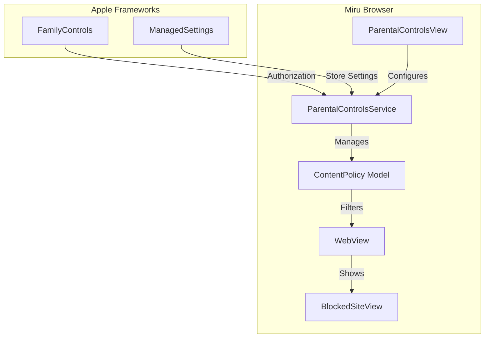

# Screen Time Parental Controls Implementation

## Overview

Build a complete parental control system for Miru Browser using Apple's Screen Time frameworks (FamilyControls, ManagedSettings). Parents in the same iCloud family can authorize themselves, configure an allowlist of permitted websites, and the browser will block navigation to any sites not on the list.

## Architecture

## Key Implementation Details

### Phase 1: Framework Integration

Add the required frameworks and entitlements:

**Entitlements** ([`Miru Browser/Miru Browser.entitlements`](Miru Browser/Miru Browser.entitlements)(Miru Browser/Miru Browser.entitlements)(Miru Browser/Miru Browser.entitlements)):

- `com.apple.developer.family-controls` - Required for FamilyControls authorization

**New Service** - `Services/ParentalControlsService.swift`:

- Request FamilyControls authorization from parent/guardian
- Use `AuthorizationCenter.shared.requestAuthorization(for: .individual)` for family members
- Store authorization state
- Manage ManagedSettingsStore for persisting restrictions

### Phase 2: Content Policy Model

**New Model** - `Models/ContentPolicy.swift`:

- `@Observable` class to store parental control settings
- `isEnabled: Bool` - Whether restrictions are active
- `allowedDomains: Set<String>` - Allowlisted domains (e.g., "apple.com", "wikipedia.org")
- Persistence using ManagedSettingsStore or UserDefaults (protected by parent auth)
- Helper method: `isURLAllowed(_ url: URL) -> Bool` with domain matching

### Phase 3: WebView Content Filtering

**Modify** [`Miru Browser/Views/WebView.swift`](Miru Browser/Views/WebView.swift)(Miru Browser/Views/WebView.swift)(Miru Browser/Views/WebView.swift):

- Inject `ParentalControlsService` or `ContentPolicy` 
- In `webView(_:decidePolicyFor:decisionHandler:)`, check if URL is allowed
- If URL is blocked, cancel navigation and show BlockedSiteView
- Handle redirects and embedded content

### Phase 4: Parental Controls UI

**New View** - `Views/ParentalControlsView.swift`:

- Authorization request button (if not authorized)
- Toggle for enabling/disabling restrictions
- List of allowed websites with add/remove functionality
- Pre-populated suggestions (educational sites, search engines)

**New View** - `Views/BlockedSiteView.swift`:

- Displayed when a blocked URL is accessed
- Shows the blocked domain
- "Go Back" button
- "Request Access" button (sends notification to parent - optional)

**Modify** [`Miru Browser/Views/SettingsView.swift`](Miru Browser/Views/SettingsView.swift)(Miru Browser/Views/SettingsView.swift)(Miru Browser/Views/SettingsView.swift):

- Add "Parental Controls" navigation link
- Show lock icon if restrictions are enabled

### Phase 5: App Entry Point Updates

**Modify** [`Miru Browser/Miru_BrowserApp.swift`](Miru Browser/Miru_BrowserApp.swift)(Miru Browser/Miru_BrowserApp.swift)(Miru Browser/Miru_BrowserApp.swift):

- Initialize ParentalControlsService as `@State`
- Pass to environment for app-wide access

## Files to Create

| File | Purpose |

|------|---------|

| `Services/ParentalControlsService.swift` | FamilyControls auth + ManagedSettings integration |

| `Models/ContentPolicy.swift` | Allowlist storage and URL filtering logic |

| `Views/ParentalControlsView.swift` | Parent-facing settings UI |

| `Views/BlockedSiteView.swift` | Shown when blocked URL is accessed |

## Files to Modify

| File | Changes |

|------|---------|

| `Miru Browser.entitlements` | Add Family Controls entitlement |

| `Views/WebView.swift` | Add URL filtering in navigation delegate |

| `Views/SettingsView.swift` | Add Parental Controls navigation link |

| `Miru_BrowserApp.swift` | Initialize and inject ParentalControlsService |

## Important Considerations

1. **Family Sharing Required**: The parent must be in the same iCloud Family Sharing group as the child using the device. FamilyControls authorization only works within a family.

2. **iOS Version**: FamilyControls requires iOS 15+. Your app targets iOS 26+, so this is not an issue.

3. **App Store Review**: Apps using FamilyControls must explain their parental control functionality to Apple during review.

4. **Testing**: FamilyControls authorization cannot be tested in the simulator. You'll need physical devices with Family Sharing configured.

5. **Default Allow List**: Consider including default allowed sites like "apple.com" for App Store links to work.