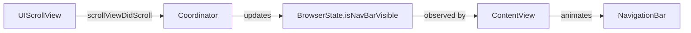

# Scroll-Hide Navigation Bar

## Architecture

The WebView Coordinator already implements `UIScrollViewDelegate` for pull-to-refresh. We will extend `scrollViewDidScroll` to track scroll direction and update a new state property that drives the navigation bar visibility.




## Implementation

### 1. Add visibility state to BrowserState

Add a new property to [`Miru Browser/Models/BrowserState.swift`](Miru Browser/Models/BrowserState.swift)(Miru Browser/Models/BrowserState.swift)(Miru Browser/Models/BrowserState.swift)(Miru Browser/Models/BrowserState.swift)(Miru Browser/Models/BrowserState.swift):

```swift
// Navigation bar auto-hide state
var isNavBarVisible: Bool = true
```


### 2. Track scroll direction in WebView Coordinator

Modify the `Coordinator` class in [`Miru Browser/Views/WebView.swift`](Miru Browser/Views/WebView.swift)(Miru Browser/Views/WebView.swift)(Miru Browser/Views/WebView.swift)(Miru Browser/Views/WebView.swift)(Miru Browser/Views/WebView.swift):

- Add a `lastContentOffset` property to track previous scroll position
- Update `scrollViewDidScroll` to detect scroll direction
- Apply a velocity threshold (~10 pts) to prevent flickering on tiny scrolls
- Always show the nav bar when at the top of the page

### 3. Animate NavigationBar visibility in ContentView

Update both `portraitBrowserView` and `landscapeBrowserView` in [`Miru Browser/ContentView.swift`](Miru Browser/ContentView.swift)(Miru Browser/ContentView.swift)(Miru Browser/ContentView.swift)(Miru Browser/ContentView.swift)(Miru Browser/ContentView.swift):

- Apply `.offset(y:)` and `.opacity()` modifiers to the nav bar VStack
- Use `.animation(.spring())` for smooth spring animation
- When hidden: offset down (~100pts) and fade to 0
- When visible: offset 0 and full opacity